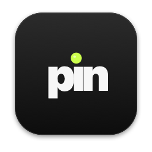

<p align="center">
  
</p>

<h1 align="center">pin</h1>

<p align="center">
  <b>Your Pinterest feed as a screensaver.</b><br>
  A slowly scrolling wall of pins when your computer idles, and an app to see, save and weed out what it shows.<br>
  For macOS and Windows.
</p>

<p align="center">
  <a href="https://github.com/YuvrajxGarg/pin/releases/latest"></a>
  
  <a href="LICENSE"></a>
</p>

## Download

| Platform | Download | First launch |
|---|---|---|
| **macOS** 12+ · Apple silicon | [**Pin.dmg**](https://github.com/YuvrajxGarg/pin/releases/latest/download/Pin.dmg) | Open the disk image and drag **Pin** to Applications. The app isn't notarized, so the first time: right-click → **Open** (on macOS 15 and later: **System Settings → Privacy & Security → Open Anyway**). When macOS asks whether Pin may access data from other apps, click **Allow**: that's where the screensaver keeps its pins. |
| **Windows** 10 / 11 · 64-bit | [**Pin-Setup.exe**](https://github.com/YuvrajxGarg/pin/releases/latest/download/Pin-Setup.exe) | Run the setup. It installs for your user only, no admin needed. If SmartScreen appears, click **More info → Run anyway**. |

Then click **Install** in Pin's sidebar to add the screensaver. Pin checks this repository for new releases and updates itself, and the screensaver updates with it. It's also in [PXL](https://github.com/YuvrajxGarg/pxl).

## What it does

- **The screensaver** fills the screen with masonry columns of pins that drift upward at slightly different speeds, with an optional clock. It keeps up to 200 pins on disk, so it starts instantly and works offline.
- **The app** shows every pin the screensaver has. Click one to see it large (← → to flip through), **Save** it as a normal JPG/PNG (to `Pictures/Pin` or anywhere), **Copy** it, or **Hide** it. Hidden pins never show in the screensaver and aren't downloaded again; the **Hidden** tab brings them back. ⌘/Ctrl-click to pick several.
- **Refresh** (⌘R / Ctrl+R) pulls new pins now. **Start over** drops the cache and fetches a fresh set.
- **Source**: any public profile or board (`nasa`, `nasa/space`, or a board link) through Pinterest's RSS, no login. Or your own home feed: paste your `_pinterest_sess` cookie (the app shows how). The cookie stays on your computer and is only sent to pinterest.com.
- Scroll speed, tile size and the clock are set from the sidebar and apply the next time the screensaver starts.

## How it fits together

```
pin/                 the app: Python + pywebview (WebKit on macOS, WebView2 on Windows)
  webapp.py          window and the API the UI calls
  saver.py           the screensaver's settings file, pin cache, install
  feed.py            fetching pins (RSS or home feed), the same way the screensaver does
  updater.py         GitHub Releases updater (shared with Tag and Dwn)
  ui/                HTML, CSS and JS
saver/mac/           the macOS screensaver (Swift ScreenSaverView, built with just the Command Line Tools)
saver/windows/       the Windows screensaver (.NET 8 WPF, a .scr)
installer/           DMG and Inno Setup wizard
```

The app and the screensaver share one settings file and one image cache, so a hidden pin is hidden everywhere. On macOS the screensaver runs inside `legacyScreenSaver`'s sandbox, so both live in that app's container (`~/Library/Containers/com.apple.ScreenSaver.Engine.legacyScreenSaver/Data/Library/…/PinterestSaver`). On Windows they're in `%APPDATA%\PinterestSaver` and `%LOCALAPPDATA%\PinterestSaver`. The folder names are the ones the earlier "Pinterest Saver" used, so its settings and pins carry over, and installing Pin's screensaver replaces it.

## Build from source

```bash
uv venv -p 3.12 .venv && uv pip install -p .venv/bin/python -r requirements.txt pyinstaller
.venv/bin/python Pin.py                 # run the app
.venv/bin/python -m unittest discover tests
```

| | |
|---|---|
| **macOS app** | `./build_mac.sh` builds the screensaver and `dist/Pin.app`. `--install` copies it to `~/Applications`, `--release` also makes the update zip and `Pin.dmg`. |
| **Windows app** | `build_windows.bat` (needs Python 3.9+ and the .NET 8 SDK) builds `dist\Pin\Pin.exe`. |
| **UI in a browser** | `python -m http.server -d pin/ui` and open `index.html?demo`, or `PIN_SAVER_LIBRARY=/tmp/pin python tools/dev_server.py` for the real API. |
| **Screensaver alone** | `saver/mac/build.sh`; `swiftc test/main.swift Sources/*.swift …` renders it offscreen to a PNG (see `saver/mac/test/main.swift`). |

Command line: `Pin info`, `Pin list`, `Pin refresh [--start-over]`, `Pin install-saver` (on macOS the binary is `Pin.app/Contents/MacOS/Pin`).

## Releasing

Push a `v1.2.3` tag. GitHub Actions builds both apps and both screensavers, tests them, and attaches `Pin.dmg`, `Pin-Setup.exe` and the updater zips to the release. The release stays a draft until every file is there.
